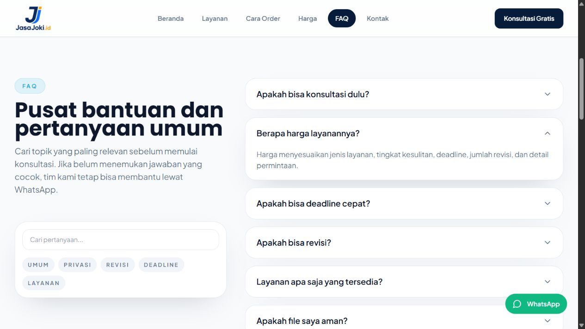

# JasaJoki.id — Website Layanan

Implementasi website untuk menyajikan informasi layanan JasaJoki.id, alur pemesanan, estimasi kebutuhan, FAQ, dan kanal konsultasi. Proyek menggunakan React dengan navigasi beberapa halaman dan formulir yang menyusun pesan WhatsApp dari input pengguna.

Dokumentasi ini menjelaskan implementasi web di repositori. Angka pemasaran, testimoni, dan contoh kebutuhan pada halaman bersumber dari konten statis aplikasi; bukan hasil pengukuran performa atau pencapaian pengembangan yang diverifikasi oleh repositori.

## Dokumentasi tampilan



Tangkapan layar aplikasi lokal pada route `/faq`, setelah pertanyaan **Berapa harga layanannya?** dibuka. Gambar memperlihatkan implementasi halaman dan interaksi FAQ, bukan bukti transaksi layanan.

## Fitur

- Halaman beranda, layanan, cara order, harga, FAQ, dan kontak.
- Navigasi desktop, menu ponsel, dan navigasi bawah untuk layar kecil.
- Katalog layanan, contoh kebutuhan, dan informasi faktor estimasi harga.
- Form konsultasi dengan validasi field wajib menggunakan React Hook Form.
- Penyusunan pesan konsultasi dan estimasi menjadi tautan WhatsApp.
- Animasi antarmuka menggunakan Framer Motion.
- Pengaturan judul halaman, deskripsi, dan metadata Open Graph di sisi klien.
- Tautan untuk melewati navigasi menuju konten utama.

## Teknologi

| Bagian | Implementasi |
| --- | --- |
| Antarmuka | React 18, JavaScript |
| Build | Vite 5, plugin React SWC |
| Tampilan | Tailwind CSS 3, Lucide React |
| Navigasi | React Router DOM 6 |
| Animasi | Framer Motion 11 |
| Form | React Hook Form 7 |

## Menjalankan secara lokal

Persyaratan: Git, Node.js, dan npm. Repositori belum menetapkan versi Node.js melalui `engines`; gunakan versi yang kompatibel dengan Vite 5.

```sh
git clone https://github.com/samsuldwicahyo/jasajokiid.git
cd jasajokiid
npm ci
npm run dev
```

Buka alamat yang tercetak di terminal, biasanya `http://localhost:5173`. Vite dapat memilih port berikutnya apabila port tersebut sedang digunakan. Implementasi saat ini tidak memerlukan backend atau API key untuk menampilkan halaman dan membentuk tautan WhatsApp.

### Perintah proyek

| Perintah | Fungsi |
| --- | --- |
| `npm run dev` | Menjalankan server pengembangan. |
| `npm run build` | Membuat build produksi di `dist/`. |
| `npm run preview` | Meninjau build secara lokal; jalankan build terlebih dahulu. |

Script `lint` dan `test` belum tersedia dalam [package.json](./package.json).

## Halaman

| Route | Isi |
| --- | --- |
| `/` | Ringkasan layanan dan informasi utama. |
| `/layanan` | Daftar layanan. |
| `/cara-order` | Tahapan pemesanan. |
| `/harga` | Informasi harga dan formulir estimasi kebutuhan. |
| `/faq` | Pertanyaan yang sering diajukan. |
| `/kontak` | Kanal komunikasi dan formulir konsultasi. |

Route yang tidak dikenali saat ini menampilkan komponen beranda, bukan halaman 404 khusus.

## Alur formulir dan WhatsApp

1. Pengguna mengisi formulir konsultasi atau estimasi kebutuhan.
2. React Hook Form memeriksa field wajib yang ditentukan oleh masing-masing form.
3. Fungsi di [`src/utils/whatsapp.js`](./src/utils/whatsapp.js) merapikan nilai dan membentuk pesan dengan `encodeURIComponent`.
4. Aplikasi membuka tautan `wa.me` berisi pesan tersebut. Pengguna meninjau dan mengirim pesan melalui WhatsApp.

Form **tidak mengirim pesan secara otomatis**, tidak menyimpan data ke database, dan tidak mencatat pesanan pada backend. Berhasil membuka WhatsApp juga tidak membuktikan pesan sudah terkirim atau dibaca.

## Menyesuaikan konten

| Kebutuhan | Berkas |
| --- | --- |
| Layanan, contoh kebutuhan, faktor harga, dan teks utama | [`src/data/services.js`](./src/data/services.js) |
| Pertanyaan dan jawaban | [`src/data/faqs.js`](./src/data/faqs.js) |
| Konten testimoni | [`src/data/testimonials.js`](./src/data/testimonials.js) |
| Nomor WhatsApp, email, Instagram, dan format pesan | [`src/utils/whatsapp.js`](./src/utils/whatsapp.js) |
| Route halaman | [`src/App.jsx`](./src/App.jsx) |
| Warna dan konfigurasi tampilan | [`tailwind.config.js`](./tailwind.config.js), [`src/index.css`](./src/index.css) |

Verifikasi angka pemasaran, izin penggunaan testimoni, kontak tujuan, dan isi layanan sebelum memakai konten untuk publikasi bisnis. Contoh kebutuhan pada komponen `Portfolio` telah diberi keterangan sebagai contoh *dummy*, bukan bukti pekerjaan klien.

## Struktur kode

```text
src/
  App.jsx                 # Route, navigasi halaman, dan susunan layout
  main.jsx                # Entry React dan BrowserRouter
  assets/                 # Logo dan ilustrasi
  components/             # Bagian halaman dan komponen bersama
  data/                   # Konten layanan, FAQ, dan testimoni
  pages/                  # Enam halaman utama
  utils/whatsapp.js       # Kontak dan pembentuk pesan WhatsApp
  index.css               # Style global
public/                   # Aset statis
vercel.json               # Rewrite route SPA
```

## Build dan hosting

```sh
npm run build
npm run preview
```

Direktori output adalah `dist/`. [vercel.json](./vercel.json) telah menyediakan rewrite ke `index.html` untuk route SPA. Pada hosting lain, tambahkan fallback yang sesuai agar membuka atau memuat ulang `/layanan`, `/harga`, dan route lainnya tetap menampilkan aplikasi. Ketersediaan domain tertentu tidak dijamin oleh repositori ini.

## Batasan implementasi

- Belum ada backend, database pelanggan, dashboard admin, autentikasi, pembayaran, atau pelacakan status pesanan.
- Konten layanan dan testimoni dikelola melalui berkas sumber; belum ada CMS.
- Validasi form berjalan di browser. Penggunaan WhatsApp bergantung pada aplikasi/browser pengguna dan kontak tujuan.
- Metadata per halaman diperbarui setelah JavaScript berjalan; belum ada server-side rendering atau prerendering.
- Belum ada laporan hasil pengujian otomatis dalam repositori.

## Rencana pengujian QA

Daftar berikut merupakan **skenario pengujian yang disarankan**, bukan laporan pengujian yang telah lulus.

- [ ] Buka setiap route melalui menu, tautan langsung, dan refresh browser.
- [ ] Periksa menu ponsel, navigasi bawah, serta tautan untuk melewati navigasi.
- [ ] Periksa field wajib ketika kosong dan setelah terisi; pastikan pesan kesalahan sesuai.
- [ ] Gunakan data contoh untuk memeriksa format pesan, karakter khusus, baris baru, serta nilai opsional yang kosong.
- [ ] Tinjau tautan WhatsApp tanpa mengirim pesan kepada kontak asli selama pengujian.
- [ ] Periksa perilaku ketika popup diblokir atau WhatsApp tidak tersedia.
- [ ] Periksa FAQ, perpindahan halaman, judul halaman, dan metadata yang diperbarui.
- [ ] Periksa navigasi keyboard, fokus, kontras, serta tata letak pada ponsel dan desktop.

## Lisensi

Repositori belum memiliki berkas `LICENSE` yang menetapkan lisensi penggunaan secara terpisah.
